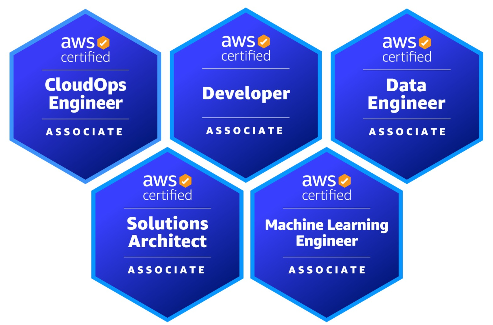
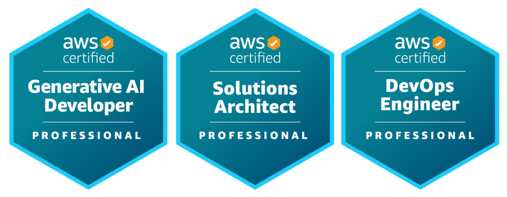

# Сертификаты AWS

## ФУНДАМЕНТАЛЬНЫЙ (FOUNDATIONAL)
Сертификация на основе знаний для базового понимания AWS Cloud. **Предварительный опыт не требуется.**

Сертификаты:

- Cloud Practitioner — Фундаментальный
- AI Practitioner — Фундаментальный

{: width=350 height=200}

 

## СПЕЦИАЛИСТ (ASSOCIATE)
Ролевые сертификаты, демонстрирующие знания и навыки работы с AWS и укрепляющие вашу репутацию как профессионала AWS Cloud. **Рекомендуется предварительный опыт работы с облачными технологиями и/или серьёзный опыт работы с локальной IT-инфраструктурой.**

Сертификаты:

- CloudOps Engineer — Специалист
- Developer — Специалист
- Data Engineer — Специалист
- Solutions Architect — Специалист
- Machine Learning Engineer — Специалист

{: width=350 height=210}

 

## ПРОФЕССИОНАЛЬНЫЙ (PROFESSIONAL)
Ролевые сертификаты, подтверждающие продвинутые навыки и знания, необходимые для проектирования безопасных, оптимизированных и современных приложений, а также для автоматизации процессов на AWS. **Рекомендуется 2 года предварительного опыта работы с AWS Cloud.**

Сертификаты:

- Generative AI Developer — Профессиональный
- Solutions Architect — Профессиональный
- DevOps Engineer — Профессиональный

{: width=350 height=130}

 

## СПЕЦИАЛИЗАЦИЯ (SPECIALTY)
Углубите знания и станьте доверенным советником для ваших заинтересованных сторон и/или клиентов в этих стратегических областях. **Рекомендуемый опыт указан в руководствах по экзаменам на страницах соответствующих экзаменов.**

Сертификаты:

- Advanced Networking — Специализация
- Security — Специализация

{: width=350 height=200}

