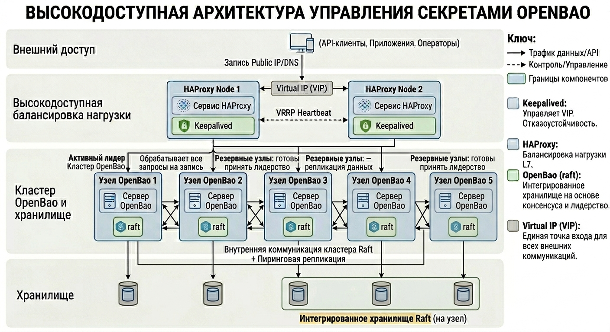

# Конфигурация OpenBao

{: width=500 height=300}

bao operator init - только в основном ноде 
sudo export BAO_ADDR="http://NODE_IP:8200" - Во всех нодах 
bao operator raft list-peers 
echo 'BAO_ADDR="http://NODE_IP:8200"' > /etc/environment 

Для настройки OpenBao в продакшен среде, нужен следущие компоненты:

1. 2 сервера для HaProxy
2. 5 серверов для OpenBao 

{: width=800 height=500}

